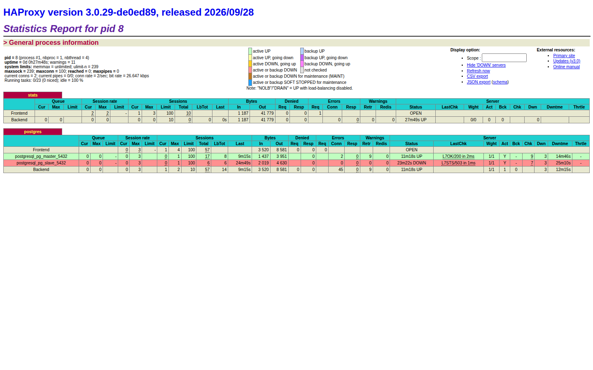

# ЛР 3. HA Postgres Cluster

Стенд поднят, репликация проверена, мастер принудительно выключен. Запись через HAProxy после этого прошла уже на бывшую реплику. Когда остановленная нода вернулась, она сама забрала строки, которые появились без неё.

Кластер сейчас работает: Postgres на `127.0.0.1:5433` и `:5434`, вход для клиентов `127.0.0.1:5432`, статистика HAProxy на [http://127.0.0.1:7000/](http://127.0.0.1:7000/).

## Состав

- Postgres 15 и Patroni 3.3.2 в одном образе (`Dockerfile`). Patroni нужен доступ к бинарникам Postgres, поэтому отдельный контейнер только с Patroni не собирался.
- ZooKeeper `confluentinc/cp-zookeeper:7.7.1` хранит lock лидера и состав кластера.
- HAProxy 3.0 публикует один порт 5432 и проверяет Patroni REST на порту 8008.

Учётные данные из методички: пользователь `postgres`, пароль `postgres`, база `postgres`. Репликация идёт пользователем `replicator`.

От методички пришлось отойти в нескольких местах, иначе Postgres 15 или этот Docker просто не стартуют. Что именно и зачем, ниже по шагам.

## Часть 1. Postgres и Patroni

Образ собирается из `postgres:15`. В нём venv `/opt/patroni-venv` и зафиксированный `patroni[zookeeper]==3.3.2`. Версия важна: в 3.3.2 запрос `GET /` и `OPTIONS /` обрабатываются как проверка primary. Конфиг HAProxy из методички (`option httpchk` без URI) как раз шлёт `OPTIONS /` и поэтому красит в UP только лидера.

`docker compose up -d --build` поднял четыре контейнера. ZooKeeper открыл `0.0.0.0:2181`. В логе `pg-master`:

```text
Zookeeper connection established, state: CONNECTED
Lock owner: None; I am postgresql0
trying to bootstrap a new cluster
initialized a new cluster
Lock owner: postgresql0; I am postgresql0
no action. I am (postgresql0), the leader with the lock
```

`pg-slave` lock инициализации не взял (`NodeExistsError` на `/service/my_cluster/initialize` — его уже создал первый узел) и снял копию с лидера:

```text
Lock owner: postgresql0; I am postgresql1
trying to bootstrap from leader 'postgresql0'
replica has been created using basebackup
no action. I am (postgresql1), a secondary, and following a leader (postgresql0)
```

Роли разъехались так: порт 5433 — primary, порт 5434 — replica, в `pg_stat_replication` состояние `streaming`, `sync_state = sync`. Имя контейнера тут совпало с ролью. Методичка предупреждает, что так будет не всегда, и дальше по прогону лидер действительно переехал.

### Что поправлено относительно текста лабы

`wal_keep_segments` в PostgreSQL 15 уже нет, сервер с ним не стартует. В конфиге стоит `wal_keep_size: 128MB` — те же 8 сегментов по 16 МБ.

Именованный volume Docker создаёт каталог от root. Официальный entrypoint образа чинит права только если команда — `postgres`, а у нас команда — `patroni`. Поэтому `entrypoint.sh` делает `chown` и дальше `gosu postgres`. Без этого Patroni не создаёт `data_dir`.

## Часть 2. Репликация

На лидере (`127.0.0.1:5433`):

```text
CREATE TABLE lab_ha (
    id int PRIMARY KEY,
    note text NOT NULL,
    written_at timestamptz NOT NULL DEFAULT now()
);
INSERT INTO lab_ha (id, note) VALUES (1, 'записано на исходном лидере');
```

Ответ:

```text
 id |            note
----+-----------------------------
  1 | записано на исходном лидере
```

Тот же `SELECT` на реплике (`127.0.0.1:5434`) вернул ту же строку. Синхронная репликация включена в DCS (`synchronous_mode: true`), поэтому коммит на лидере дождался реплики, и строка была видна сразу.

Запись на реплику:

```text
INSERT INTO lab_ha (id, note) VALUES (99, 'это не должно записаться');
ERROR:  cannot execute INSERT in a read-only transaction
```

Код выхода `psql` — 1. Реплика в recovery и пишет только то, что приехало с лидера.

## Часть 3. HAProxy

HAProxy проверяет оба узла по порту 8008. Пока лидером был `pg-master`, CSV статистики выглядел так:

```text
postgresql_pg_master_5432  UP    L7OK  200
postgresql_pg_slave_5432   DOWN  L7STS 503
```

503 на реплике — это не «узел умер». Patroni так отвечает на health-check, если узел не primary. В пул балансировщика попадает только тот, кто держит lock, поэтому запись на `127.0.0.1:5432` не попадает на read-only ноду.

Снимок страницы статистики в текущем состоянии кластера (после серии отказов лидером снова стал `pg-master`): розовая строка — реплика, HAProxy её в пул не берёт.



Конфиг HAProxy запечён в образ (`Dockerfile.haproxy`), а не примонтирован файлом. Демон Docker в этом окружении не видит каталог проекта: bind-mount несуществующего для него пути превратился в пустой каталог, и процесс HAProxy падал с usage. Содержимое `haproxy.cfg` то же, что в методичке.

## Задание. Выключение мастера

Перед остановкой лидером был `pg-master`, реплика `pg-slave` была synchronous. В 13:31:08 UTC:

```bash
docker stop pg-master
```

Сразу писать в `127.0.0.1:5432` было нельзя: HAProxy ещё вёл сессии на умерший бэкенд (`server closed the connection unexpectedly`). На седьмой попытке, примерно через 20 секунд ожидания плюс время проверок, `INSERT` прошёл.

Что произошло по логам `pg-slave`. Пока контейнер `pg-master` мёртв, его DNS-имя в сети compose пропадает, реплика не может дотянуть WAL:

```text
could not connect to the primary server: could not translate host name "pg-master" to address
```

Lock в ZooKeeper — эфемерный узел сессии Patroni. Сессия умерла вместе с процессом. `ttl` в конфиге 30 секунд, `loop_wait` 10. В 13:31:48, через 40 секунд после `docker stop`, выжившая нода забрала lock и сделала promote:

```text
promoted self to leader by acquiring session lock
received promote request
selected new timeline ID: 2
database system is ready to accept connections
no action. I am (postgresql1), the leader with the lock
```

HAProxy после этого:

```text
postgresql_pg_master_5432  DOWN  L4TOUT
postgresql_pg_slave_5432   UP    L7OK  200
```

Старый мастер не отвечает по TCP (таймаут L4). Новый отвечает 200 на проверку лидера. `on-marked-down shutdown-sessions` рвёт сессии, которые ещё висели на упавшем сервере.

Чтение через точку входа:

```text
 id |                    note                     | this_connection_is_replica
----+---------------------------------------------+----------------------------
  1 | записано на исходном лидере                 | f
  2 | записано через HAProxy после падения лидера | f
```

`pg_is_in_recovery() = f` — соединение пришло на новый primary, не на реплику. Строка 1 пережила promote, строка 2 записана уже после него. Окно недоступности было, потерянных коммитов не было: реплика до остановки была synchronous и получила WAL до обрыва.

### Возврат ноды

Дальше `docker start pg-master` и ещё одна вставка через HAProxy, пока старый лидер поднимается:

```text
INSERT ... VALUES (3, 'записано, пока старый лидер возвращался');
```

Patroni на вернувшейся ноде увидел, что lock уже у `postgresql1`, локальный timeline 1, а у кластера timeline 2, и запустил `pg_rewind`. Rewind упал:

```text
pg_rewind: error: could not open target file
  "/var/lib/postgresql/data/postgresql0/.s.PGSQL.5432": No such device or address
pg_rewind exit code=1
remove_data_directory_on_rewind_failure is set. removing...
replica has been created using basebackup
no action. I am (postgresql0), a secondary, and following a leader (postgresql1)
```

Сокет лежал внутри каталога данных из-за `unix_socket_directories: '.'` в методичке. `pg_rewind` обходит файлы PGDATA и не умеет открыть unix-сокет как файл. Без страховки нода так и осталась бы с разошедшимся timeline и не увидела бы новые строки.

В конфиге включены

```yaml
remove_data_directory_on_rewind_failure: true
remove_data_directory_on_diverged_timelines: true
```

Patroni снёс каталог и собрал реплику заново через `pg_basebackup` с нового лидера. На второй проверке порт 5433 уже был replica и содержал все три строки. Порт 5434 (новый лидер) содержал те же три. Данные, записанные в отсутствие ноды, на неё приехали.

Сокет после этого перенесён в `/tmp`, а `entrypoint.sh` при старте удаляет случайные `.s.PGSQL.*` из PGDATA. Иначе следующий rewind снова спотыкается о сокет, оставшийся от прошлого запуска. Страховка со сносом каталога оставлена: если WAL уже не из чего отмотать, нода всё равно клонируется с лидера, а не зависает.

Отдельно, чтобы не наступить на это при защите. `synchronous_mode: true` пускает в автоматическую гонку только бывшего лидера и synchronous standby. Если остановить primary до того, как в ZooKeeper в ключе `/sync` появился `sync_standby` (там будет `null`), реплика напишет `following a different leader because i am not the healthiest node` и не промоутится, пока не вернётся старый лидер. В засчитанном прогоне реплика уже была `sync`, поэтому promote прошёл. `scripts/demo.sh` теперь сам ждёт `sync_state = sync` и не останавливает лидера раньше.

## Ответы на вопросы

**Чем `expose` отличается от `ports`?**

`ports` публикует порт на хост. `5433:5432` значит, что снаружи контейнера Postgres доступен как `127.0.0.1:5433`. `expose` порт на хост не открывает: 8008 остаётся только в сети compose, и HAProxy ходит на `pg-master:8008` по внутреннему DNS. На современной user-defined сети контейнеры и так видят порты друг друга, `expose` здесь в основном документ «этот порт для соседей, не для хоста». Если записать 8008 в `ports`, проверка Patroni станет доступна снаружи. Для работы кластера это не нужно.

**Пересоберётся ли образ при обычном перезапуске? А если поменять `postgresX.yml`? А если Dockerfile?**

`docker compose up` и `docker compose restart` образ не собирают. Берётся уже существующий `localhost/postgres:patroni`.

`postgres0.yml` и `postgres1.yml` попадают в образ инструкцией `COPY`, они не примонтированы. Правка файла на хосте ничего не меняет в работающем контейнере, пока нет новой сборки: слой образа неизменяемый. То же с `Dockerfile`. Сборка запускается явно, `docker compose up -d --build` или `docker compose build`.

При этой сборке кэш устроен по слоям. Правка только yaml инвалидирует `COPY` и всё, что ниже него. Правка `RUN apt-get` или `pip install` инвалидирует этот `RUN` и все следующие слои, базовые слои выше остаются в кэше.

## Итог

Кластер из двух Postgres, Patroni и ZooKeeper выбирает лидера сам. HAProxy пускает клиентов только на primary. После `docker stop` текущего мастера второй узел забрал lock, поднял timeline и принял запись через порт 5432. Вернувшаяся нода стала репликой и получила строки, записанные без неё: сначала попыткой `pg_rewind`, а когда сокет в PGDATA это сломал — полным `pg_basebackup`.
