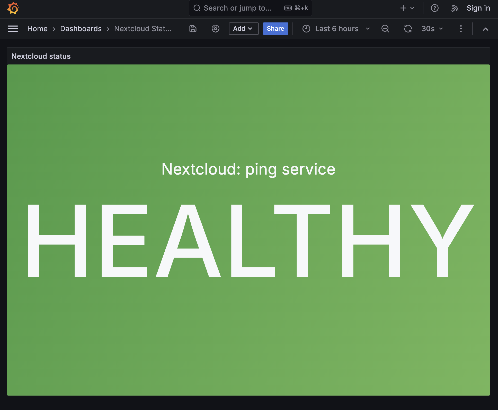
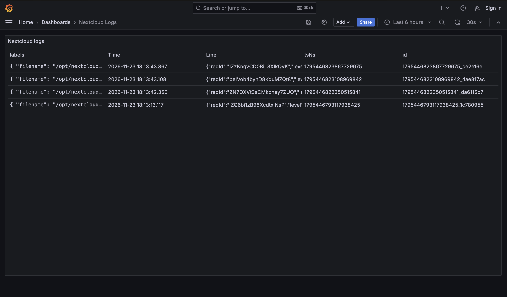

# ЛР 2. Loki + Zabbix + Grafana

## Цель работы

Подключить к тестовому сервису Nextcloud сбор логов и мониторинг состояния, затем вывести полученные данные в Grafana.

## Состав стенда

В `docker-compose.yml` описаны семь контейнеров:

- `nextcloud` - тестовый сервис;
- `loki` - хранение и обработка логов;
- `promtail` - чтение `nextcloud.log` и отправка записей в Loki;
- `postgres-zabbix` - база данных Zabbix;
- `zabbix-back` - сервер Zabbix;
- `zabbix-front` - веб-интерфейс и API Zabbix;
- `grafana` - визуализация данных Loki и Zabbix.

Данные Nextcloud, PostgreSQL и Grafana хранятся в именованных Docker volumes. Поэтому обычный перезапуск контейнеров не удаляет настройки.

## Часть 1. Логирование

Nextcloud публикуется на порту 8080 и при первом запуске автоматически создает учетную запись `admin`. Его каталог `/var/www/html` находится в общем volume. Тот же volume подключен к Promtail в режиме только для чтения.

Promtail ищет файлы по маске `/opt/nextcloud/data/*.log` и добавляет к потоку метки `job=nextcloud_logs` и `service=nextcloud`. Клиент Promtail отправляет записи на `http://loki:3100/loki/api/v1/push`.

После обращения к Nextcloud в файле `data/nextcloud.log` появились записи. В логах Promtail видно обнаружение файла, а Loki возвращает метку `nextcloud_logs`.

Для проверки в Grafana Explore использованы запросы:

```logql
{job="nextcloud_logs"}
{job="nextcloud_logs"} |= "error"
{job="nextcloud_logs"} | json
```

Первый запрос показывает все записи Nextcloud. Второй оставляет строки с текстом `error`. Третий разбирает JSON и позволяет фильтровать логи по полям записи.

## Часть 2. Мониторинг

В Zabbix импортирован шаблон `Test ping template` из файла `zabbix-template.yml`. В шаблоне создан HTTP agent item `nextcloud.ping`, который запрашивает `http://{HOST.HOST}/status.php`.

Из ответа извлекается поле `maintenance`. Значение `false` преобразуется в `healthy`, а `true` - в `unhealthy`. Для состояния `unhealthy` создан триггер с уровнем Disaster.

Создан хост `nextcloud` с видимым именем `Nextcloud Server`, группой `Applications` и подключенным шаблоном. Docker DNS разрешает имя `nextcloud` внутри общей сети Compose, поэтому Zabbix обращается к сервису без публикации дополнительного внутреннего порта.

В **Monitoring → Latest data** элемент `Nextcloud: ping service` получил значение `healthy`.

## Часть 3. Визуализация

В Grafana подключены два источника данных:

- Loki - `http://loki:3100`;
- Zabbix - `http://zabbix-web:8080/api_jsonrpc.php`.

Созданы два дашборда:

1. `Nextcloud Status` - цветная панель Zabbix. Значение `healthy` отображается зеленым цветом, `unhealthy` - красным.



2. `Nextcloud Logs` - таблица Loki с временем, метками и содержимым записей `nextcloud.log`.



JSON-модели дашбордов находятся в каталоге `dashboards` и могут быть повторно импортированы в Grafana.

## Проверка результата

После настройки получены следующие результаты:

- все семь контейнеров находятся в состоянии `Up`, Nextcloud и PostgreSQL отмечены как `healthy`;
- `status.php` возвращает `installed: true`, `maintenance: false`, версию `29.0.6`;
- Promtail вывел сообщение `Seeked /opt/nextcloud/data/nextcloud.log`;
- Loki вернул поток с меткой `job="nextcloud_logs"` и записями о неудачном входе;
- Zabbix каждые 30 секунд получает для `nextcloud.ping` значение `healthy`;
- дашборд `Nextcloud Status` показывает зеленую плашку `HEALTHY`;
- дашборд `Nextcloud Logs` показывает таблицу с записями `nextcloud.log`.

## Ответы на вопросы

### 1. Чем SLO отличается от SLA?

SLO - это измеримая внутренняя цель качества сервиса, например доступность не ниже 99,9% за месяц. SLA - договоренность между поставщиком и потребителем: она закрепляет обещанный уровень сервиса, способ измерения и последствия нарушения. SLA может включать несколько SLO, но не каждая внутренняя цель становится договорным обязательством.

### 2. Чем отличается инкрементальный бэкап от дифференциального?

Инкрементальный бэкап сохраняет изменения после последнего бэкапа любого типа. Он занимает меньше места, но для восстановления нужны полный бэкап и вся последовательность инкрементальных копий.

Дифференциальный бэкап каждый раз сохраняет все изменения после последнего полного бэкапа. Он обычно растет от запуска к запуску, зато для восстановления достаточно полного бэкапа и одной последней дифференциальной копии.

### 3. В чем разница между мониторингом и observability?

Мониторинг отвечает на заранее сформулированные вопросы с помощью известных метрик, проверок и порогов: работает ли сервис, не превышена ли загрузка, сработал ли триггер.

Observability - более широкое свойство системы, позволяющее исследовать и неизвестные заранее проблемы по ее внешним данным: метрикам, логам, трассировкам и связанному контексту. Мониторинг является частью observability, но одной панели с известными проверками недостаточно, чтобы система считалась хорошо наблюдаемой.

## Итог

Логи Nextcloud собираются Promtail и доступны в Loki. Zabbix проверяет состояние приложения и преобразует его в понятное значение `healthy` или `unhealthy`. Grafana показывает состояние и логи на двух отдельных дашбордах.
